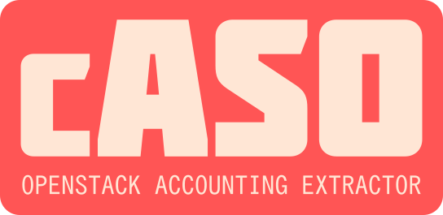
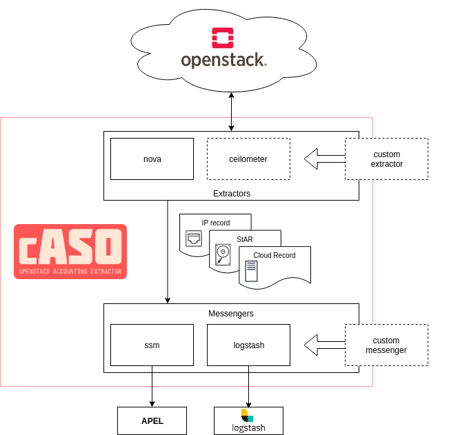

cASO is an OpenStack Accounting extractor.

* Free software: Apache license
* Source: https://github.com/IFCA-Advanced-Computing/caso
* Bugs: https://github.com/IFCA-Advanced-Computing/caso/issues

Documentation (the source is in `doc/source/`) is online at
[caso documentation](https://caso.readthedocs.org/en/latest/).

## Acknowledgement

This work has received funding from the European Union through the following projects:

 - [EOSC-hub project](http://eosc-hub.eu/) (Horizon 2020) under grant number 777536.
 - [GreenDIGIT](https://greendigit-project.eu/) (Horizon Europe) under grant number 101131207.
